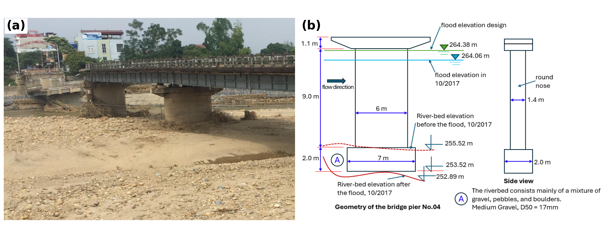

# Supplementary material

**HEC‑18 Pier Scour against Field Data: Measured versus Maximum Scour and Bridge‑Level Bounds**

*Generated by `python BaiA/make_supplement.py`; all numbers are read from `BaiA/outputs/`.*

---

## S1. Implementation of the baseline equations

All equations are implemented in `BaiA/equations.py` (SI units; D50 in mm). HEC‑18 was checked line by line against the 5th edition (Arneson et al., 2012, FHWA‑HIF‑12‑003, Sections 6.3, 7.1–7.4 and 7.11). An earlier version of our code contained four errors, which were corrected before any correction model was fitted:

| Item | HEC‑18 (5th ed.) | Earlier code | Corrected |
|---|---|---|---|
| 2.4a / 3.0a limit (Eq. 7.2) | Only for round‑nosed piers aligned with the flow | Applied to every pier | Applied only to round/circular piers with θ ≤ 5° |
| Wide‑pier factor K_w (Eq. 7.20–7.21) | Applies when y/a < 0.8, a/D50 > 50 and Fr < 1; no upper cap | Capped at 1.0 | Cap removed |
| Critical velocity for Sheppard–Melville (FDOT) | Own expression, Eq. 7.12–7.14 | HEC‑18 Eq. 6.1 used | FDOT expression implemented |
| Coarse‑bed branch (Eq. 7.34) | σ = D84/D50; clear‑water only (V < Vc); D50 ≥ 20 mm, σ ≥ 1.5 | Geometric standard deviation used; no clear‑water check | Corrected |

Other implementation choices: K₄ is omitted, as in the 5th edition (Section 7.11); the lower limit D50 = 0.2 mm is applied in Eq. 6.1; Ksf of sharp‑nosed piers in the FDOT method is not specified by HEC‑18 and is set to 1.0; missing pier length is replaced by L = a (K₂ = 1 for aligned piers).

Effect of the corrections on the evaluation set (1,253 records): the median measured/HEC‑18 ratio changed from 0.38 to 0.34, the underprediction rate from 6.2% to 4.5%, and c95 from 1.07 to 0.997. The conclusion that HEC‑18 is close to a 95% non‑exceedance envelope depends on these corrections.

CIRIA C742 (Kirby et al., 2015) is implemented as ys = a K_shape K_depth K_velocity K_angle, with factors from Gavriel (2025, Tables 2.7–2.9, Eq. 2.12) cross‑checked against CIRIA C551 (May et al., 2002, Table 4.3, Eq. 4.49–4.50) and CD 356 (Eq. A.2). See S4.

## S2. Choice of terms in the closed‑form correction

The five‑term candidate contained ln(y/a), ln(a/D50), θ/90, a cohesive‑bed indicator and a bed‑type‑unknown indicator. The coefficient of ln(y/a) was 0.052 (95% bridge‑bootstrap CI −0.026 to 0.135). Three variants were compared by OLS on ln(ys/ys,HEC‑18) (`BaiA/formula_variant_check.py`).

**Table S1.** Bridge‑grouped CV, 5 folds × 10 repetitions. The bridge‑level multiplier is exp(q95) of the bridge‑maximum out‑of‑fold residual.

| Variant | MAE (m) | s.d. | R² log | Bridge‑level 95% multiplier |
|---|---|---|---|---|
| 5 terms (with ln y/a) | 0.469 | 0.004 | 0.513 | 3.411 |
| 4 terms (adopted) | 0.472 | 0.004 | 0.513 | 3.323 |
| 2 terms (ln a/D50, θ only) | 0.483 | 0.002 | 0.482 | 3.383 |

**Table S2.** MAE (m) in the six extrapolation experiments (bridges in the test set removed from training).

| Experiment | 5 terms (with ln y/a) | 4 terms (adopted) | 2 terms (ln a/D50, θ only) |
|---|---|---|---|
| USA → non‑USA | 0.658 | 0.643 | 0.636 |
| bn ≤ 3 m → 3–5 m | 0.938 | 0.969 | 0.884 |
| bn ≤ 3 m → > 5 m | 1.254 | 1.268 | 1.303 |
| sand → gravel/cobble | 0.653 | 0.569 | 0.604 |
| gravel → sand | 0.598 | 0.585 | 0.591 |
| Fr ≤ 0.3 → > 0.5 | 0.364 | 0.354 | 0.371 |

The four‑term variant has the same in‑distribution accuracy as the five‑term one, a narrower bridge‑level multiplier, and a lower MAE in four of the six extrapolation experiments; it is slightly worse only for the two wide‑pier experiments. Removing θ and the bed indicators as well (two terms) degrades accuracy. HEC‑18 already contains (y/a)^0.35, which explains why no further y/a correction is needed.

## S3. Extrapolation: bridge‑bootstrap results for all models

Each experiment is one train/test split; uncertainty is from 2,000 bootstrap resamples of test bridges (90% intervals). M3‑S6: four‑term log‑linear correction; M4/RF4: direct XGBoost / random forest; M5/RF5/GPR5: residual XGBoost / random forest / Gaussian process.

**Table S3.** Ratio of extrapolated MAE to the MAE of the same rows under bridge‑grouped CV.

| Experiment | Rows / bridges | M3‑S6 | M4 | M5 | RF4 | RF5 | GPR5 |
|---|---|---|---|---|---|---|---|
| USA → non‑USA | 91 / 41 | 1.03 [1.00, 1.06] | 1.07 [0.97, 1.16] | 1.22 [1.10, 1.36] | 1.04 [0.92, 1.14] | 1.17 [1.09, 1.26] | 0.95 [0.81, 1.11] |
| bn ≤ 3 m → 3–5 m | 176 / 60 | 1.06 [1.00, 1.13] | 1.02 [0.89, 1.15] | 1.16 [1.03, 1.30] | 1.02 [0.89, 1.15] | 1.07 [1.00, 1.14] | 1.10 [0.91, 1.30] |
| bn ≤ 3 m → > 5 m | 80 / 34 | 1.00 [0.96, 1.04] | 1.10 [1.01, 1.19] | 1.35 [1.16, 1.57] | 1.02 [0.97, 1.06] | 1.22 [1.13, 1.33] | 1.28 [1.15, 1.43] |
| sand → gravel/cobble | 285 / 130 | 1.69 [1.51, 1.90] | 2.96 [2.47, 3.47] | 3.35 [2.85, 3.91] | 2.24 [1.90, 2.61] | 2.43 [2.07, 2.83] | 2.36 [1.98, 2.78] |
| gravel → sand | 852 / 209 | 1.10 [1.03, 1.15] | 1.16 [1.07, 1.24] | 1.31 [1.21, 1.41] | 1.16 [1.09, 1.23] | 1.28 [1.20, 1.35] | 1.35 [1.22, 1.48] |
| Fr ≤ 0.3 → > 0.5 | 111 / 66 | 1.39 [1.21, 1.58] | 1.39 [1.15, 1.69] | 1.68 [1.32, 2.14] | 1.28 [1.12, 1.45] | 1.60 [1.27, 1.99] | 2.12 [1.65, 2.67] |

**Table S4.** Difference in MAE (m) relative to M3‑S6 on the same test rows. Bold: the 90% interval excludes zero.

| Experiment | M4 | M5 | RF4 | RF5 | GPR5 |
|---|---|---|---|---|---|
| USA → non‑USA | **+0.07 [+0.00, +0.13]** | **+0.07 [+0.01, +0.13]** | +0.06 [-0.01, +0.14] | **+0.11 [+0.04, +0.19]** | +0.01 [-0.10, +0.11] |
| bn ≤ 3 m → 3–5 m | +0.06 [-0.09, +0.20] | +0.07 [-0.13, +0.25] | +0.04 [-0.16, +0.23] | -0.01 [-0.19, +0.16] | +0.06 [-0.17, +0.26] |
| bn ≤ 3 m → > 5 m | -0.15 [-0.37, +0.07] | **+0.45 [+0.20, +0.71]** | -0.19 [-0.46, +0.07] | **+0.46 [+0.21, +0.70]** | **+0.55 [+0.33, +0.77]** |
| sand → gravel/cobble | **+0.36 [+0.29, +0.43]** | **+0.47 [+0.42, +0.54]** | **+0.13 [+0.08, +0.17]** | **+0.19 [+0.16, +0.22]** | **+0.24 [+0.17, +0.31]** |
| gravel → sand | +0.02 [-0.03, +0.07] | **+0.10 [+0.05, +0.16]** | +0.02 [-0.03, +0.07] | **+0.11 [+0.06, +0.17]** | **+0.17 [+0.10, +0.24]** |
| Fr ≤ 0.3 → > 0.5 | +0.02 [-0.05, +0.10] | +0.02 [-0.00, +0.05] | -0.03 [-0.09, +0.05] | -0.00 [-0.03, +0.03] | **+0.14 [+0.07, +0.21]** |

**Table S5.** Percentage of test rows above the 95% conformal upper bound, bridge‑weighted and bridge‑max calibration.

| Experiment | M3‑S6, bridge‑weighted | M5, bridge‑weighted | M3‑S6, bridge‑max | M5, bridge‑max |
|---|---|---|---|---|
| USA → non‑USA | 6.6 [1.2, 13.6] | 17.3 [9.3, 25.5] | 4.4 [0.0, 10.7] | 8.8 [4.4, 13.5] |
| bn ≤ 3 m → 3–5 m | 1.7 [0.4, 3.5] | 7.9 [3.6, 12.6] | 0.6 [0.0, 1.8] | 2.3 [0.5, 4.7] |
| bn ≤ 3 m → > 5 m | 1.2 [0.0, 3.4] | 12.7 [4.7, 22.5] | 1.2 [0.0, 3.5] | 8.9 [2.2, 17.6] |
| sand → gravel/cobble | 0.0 [0.0, 0.0] | 0.0 [0.0, 0.0] | 0.0 [0.0, 0.0] | 0.0 [0.0, 0.0] |
| gravel → sand | 9.1 [6.3, 12.2] | 23.9 [19.3, 28.6] | 8.3 [5.8, 11.2] | 18.3 [14.8, 22.2] |
| Fr ≤ 0.3 → > 0.5 | 0.0 [0.0, 0.0] | 0.9 [0.0, 2.7] | 0.0 [0.0, 0.0] | 0.0 [0.0, 0.0] |

## S4. CIRIA C742 as an additional baseline

Factors: K_shape = 1.5 (round/circular), 2.0 (square), 1.075 (sharp); K_depth = 0.55 (y/a)^0.6 for y/a ≤ 2.7, otherwise 1; K_velocity = 0 for V/Vc ≤ 0.375, 1.6 V/Vc − 0.6 for 0.375 < V/Vc ≤ 1, and 1 for V/Vc > 1; K_angle = (cos θ + (L/a) sin θ)^0.62. Vc from HEC‑18 Eq. 6.1, or from Gavriel (2025): 0.1 D50^−0.2 for D50 < 1 mm and 0.35 D50^0.45 otherwise (D50 in mm, Vc in m/s). No factor of safety is applied (SF = 1). Records with a zero prediction count as underpredictions and are excluded from log‑scale metrics.

**Table S6.** All baseline equations on the 1,253 evaluation records.

| Equation | Zero predictions | MAE (m) | RMSE (m) | R² log | Median ratio | Underpredicted | Within ±50% | c95 |
|---|---|---|---|---|---|---|---|---|
| HEC-18 (5th ed.) | 0 | 1.680 | 2.227 | -1.01 | 0.34 | 4.5% | 17.7% | 1.00 |
| HEC-18 without K_w | 0 | 1.704 | 2.259 | -1.02 | 0.33 | 3.8% | 17.3% | 0.97 |
| HEC-18 with coarse-bed branch | 0 | 1.572 | 2.152 | -0.83 | 0.37 | 5.7% | 20.3% | 1.06 |
| Sheppard–Melville | 0 | 1.437 | 2.023 | -0.80 | 0.38 | 10.3% | 25.0% | 1.23 |
| Froehlich best-fit | 0 | 0.568 | 0.855 | 0.32 | 0.80 | 38.2% | 53.3% | 2.07 |
| Froehlich design | 0 | 1.628 | 2.394 | -0.83 | 0.36 | 2.6% | 15.0% | 0.90 |
| CIRIA C742 (Vc HEC-18) | 9 | 1.072 | 1.557 | -0.37 | 0.51 | 19.5% | 33.6% | 1.82 |
| CIRIA C742 (Vc Gavriel 2025) | 0 | 1.205 | 1.698 | -0.48 | 0.44 | 10.2% | 28.7% | 1.23 |

**Table S7.** Median measured/predicted ratio by covariate class.

| Variable | Class | n | CIRIA C742 (Vc HEC-18) | Froehlich best-fit | HEC-18 (5th ed.) |
|---|---|---|---|---|---|
| a/D50 | (0.0, 50.0] | 208 | 0.69 | 1.10 | 0.23 |
| a/D50 | (50.0, 300.0] | 179 | 0.46 | 0.75 | 0.25 |
| a/D50 | (300.0, 3000.0] | 530 | 0.49 | 0.78 | 0.40 |
| a/D50 | (3000.0, 10000000.0] | 336 | 0.49 | 0.70 | 0.41 |
| Fr | (0.0, 0.15] | 370 | 0.53 | 0.72 | 0.46 |
| Fr | (0.15, 0.3] | 453 | 0.51 | 0.76 | 0.37 |
| Fr | (0.3, 0.5] | 319 | 0.51 | 0.92 | 0.28 |
| Fr | (0.5, 2.0] | 111 | 0.46 | 0.82 | 0.19 |
| θ (deg) | (-1.0, 0.5] | 860 | 0.61 | 0.95 | 0.37 |
| θ (deg) | (0.5, 20.0] | 311 | 0.38 | 0.57 | 0.29 |
| θ (deg) | (20.0, 90.0] | 82 | 0.33 | 0.58 | 0.24 |
| bn (m) | (0, 1] | 496 | 0.60 | 0.82 | 0.38 |
| bn (m) | (1, 3] | 501 | 0.50 | 0.84 | 0.31 |
| bn (m) | (3, 5] | 176 | 0.48 | 0.74 | 0.33 |
| bn (m) | (5, 50] | 80 | 0.39 | 0.61 | 0.27 |

**Table S8.** Log‑linear corrections on the HEC‑18 and CIRIA baselines, on the records with a non‑zero CIRIA prediction (bridge‑grouped CV, 5 × 10).

| Baseline | Correction | Rows | MAE (m) | s.d. | R² log |
|---|---|---|---|---|---|
| HEC-18 | constant | 1244 | 0.565 | 0.001 | 0.380 |
| HEC-18 | 4 terms (S6) | 1244 | 0.472 | 0.003 | 0.520 |
| HEC-18 | 11 terms (S2) | 1244 | 0.480 | 0.008 | 0.508 |
| CIRIA C742 | constant | 1244 | 0.559 | 0.002 | 0.133 |
| CIRIA C742 | 4 terms (S6) | 1244 | 0.541 | 0.005 | 0.191 |
| CIRIA C742 | 11 terms (S2) | 1244 | 0.559 | 0.006 | 0.233 |

The CIRIA underprediction rate (19.5%) agrees with the 19.0% reported by Gavriel (2025) for 936 PSDb field records. Corrections built on CIRIA explain far less of the variance than corrections built on HEC‑18, because CIRIA's depth and velocity factors saturate (y/a > 2.7, V/Vc > 1) and it contains no Froude‑number term.

## S5. Data quality, the Russian subset, uncleaned data and the laboratory‑to‑field experiment

**Table S9.** Quality flags in the PSDb‑2014 field table (1,858 records). Flags are added, never used to delete records; severe flags define the core set (1,586 records).

| Flag | Records | Level | Meaning |
|---|---|---|---|
| ys = 0 | 85 | Severe | Zero scour |
| ys/bn > 3 | 25 | Severe | Possibly includes contraction scour, general scour or debris |
| Accuracy ≥ ys | 56 | Severe | Label within measurement error |
| V or y = 0 | 10 | Severe | Missing hydraulics |
| Fr > 1 | 25 | Severe | Supercritical approach flow |
| Missing core input | 87 | Severe | bn, y, V or D50 missing |
| bn < b | 2 | Severe | Geometrically impossible |
| Duplicate | 2 | Severe | Repeated record |
| Accuracy > ½ ys | 103 | Warning | Noisy label |
| θ > 0 with bn = b | 53 | Warning | Projected width probably not adjusted for skew |
| bn inconsistent | 62 | Warning | bn differs by > 0.5 ft from b cos θ + L sin θ |
| Cohesive bed | 84 | Information | Outside the main population |
| Substantial debris | 32 | Information | Outside the scope of pier equations |
| Hydraulics modelled | 407 | Information | Not measured at the time of the survey |

**Sensitivity to flagged records.** Removing records with any one of the six warning or information flags from training changes the MAE on unflagged records by at most 0.01 m. Two flags mark conditions outside the model's scope: for substantial debris, measured scour is 1.7–1.9 times the corrected prediction; for skewed piers recorded with bn = b, it is 1.5 times, consistent with a mis‑recorded projected width.

**Russian subset.** The 45 Russian records (Zhuravlyov 1978, compiled by Benedict and Caldwell 2014 via Sheppard et al. 2011) have a median measured/HEC‑18 ratio of 0.74, against 0.33 for the USA. All are round‑nosed, unskewed piers in fine sand at low velocity, rounded to 0.1 ft and without bed‑type or measurement metadata. The difference persists after conditioning on hydraulics: US records with comparable conditions (n = 161) have a median ratio of 0.53, and the regression residual is ×2.0 for the Russian subset against ×1.09 for the rest. Without the subset, the R² advantage of residual XGBoost (M5) over M3 shrinks from +0.055 to +0.042, and M5's MAE becomes worse than that of M3‑S6 (0.475 against 0.466 m).

**Hyperparameters under random splitting.** Tuned on random folds, XGBoost chose a median depth of 6 against 4 under bridge folds, and a median minimum child weight of 1.7–1.8 against 3.1–7.0; random forests chose a median depth of 13–18 against 8–12.5 and a minimum leaf size of 1 against 2–3. The unconstrained residual XGBoost (M5u) reached MAE 0.481 m under bridge CV and 0.400 m under random CV (inflation 17.0%).

**Uncleaned data.** On the uncleaned field table (1,403 computable records), the inflation of M4 with fixed hyperparameters was 11%–13%, and accuracy on the clean rows was unchanged. Cleaning mainly affects the metrics: the R² of M3‑S6 falls from 0.51 to 0.43 when noisy rows are scored.

**Laboratory to field.** The median measured/HEC‑18 ratio is 0.80 for the 525 core laboratory records against 0.34 for the field records; at equal a/D50 the field ratio is 2.1–3.3 times lower (for a/D50 < 50: 0.23 in the field against 0.73 in the laboratory). Trained on laboratory data and applied to the field, a constant factor gave MAE 1.14 m, a linear correction in y/a and a/D50 1.40 m, and XGBoost 1.27 m, against 0.47 m for the field‑trained M3‑S6. Restricting the field data to round, aligned piers does not change this; the offset is not explained by a/D50 within the flume range (15–635).

## S6. Comparison with previous machine‑learning studies

**Table S10.** Design of this study compared with typical recent ML studies and three recent field‑oriented studies.

| Aspect | Typical recent study | Kim et al. (2025) | Zhou et al. (2026) | Guo et al. (2027) | This study |
|---|---|---|---|---|---|
| Data | 100–950 points, mostly flume | 1,152 PSDb field records, screened partly by agreement with empirical equations | 552 flume + 229 field records (piles, 8 sources; 21 held out) | 646 flume tests + 400 synthetic | 1,253 PSDb field records, 370 bridges, flags documented |
| Baseline | None, or compared afterwards | None | Laboratory‑trained XGBoost (additive residual) | None | HEC‑18 (5th ed.), log residual |
| Validation | Random split | Random 80/10/10 by row | Random 85/15 + one held‑out source (21 records) | Random 80/10/10 | Bridge‑grouped (×10) and source‑grouped CV; six extrapolation tests with bridge bootstrap |
| Uncertainty | None (or Gaussian, laboratory only) | In‑sample conservatism level and global multiplier | Underprediction rate | Bootstrap of R² | Conformal bounds at row, bridge and source level |
| Leakage control | Rare | — | Partial (one source) | — | Quantified (13%–22% inflation, three model families) |
| Laboratory → field | Mixed, untested | Laboratory model overpredicts field (qualitative) | Used as base model | Laboratory only | Tested on the same HEC‑18 baseline; fails |

Representative studies reviewed for the "typical" column: Pal (2022); Ali et al. (2022); Eini et al. (2024a, b); Devi and Kaushik (2025); El Gana et al. (2025); Huynh et al. (2025a, b); Choi et al. (2025); Khan and Ismael (2026). Common features: 100–950 points, mostly from flumes; random train/test splits; reported test R² of 0.78–0.92; claims of superiority over design equations; no prediction intervals; no out‑of‑distribution tests; and, in several cases, data leakage such as noise augmentation before splitting or tuning on the test set. Khan and Ismael (2026) trained gradient boosting on the 569 PSDb laboratory cases (stratified random 80/20 split, test R² 0.96) and applied it to a field bridge. Kim et al. (2026) combined probabilistic boosting with reliability analysis for abutment scour.

### References for the Supplemental Materials (not cited in the main text)

Ali, A. S., M. M. Ashiq, S. Ebrahimi, M. S. Alasta, and M. Khorram. 2022. "Machine learning model for estimation of local scour depth around cylindrical bridge piers." *Iraqi J. Civ. Eng.* 16 (2). https://doi.org/10.37650/ijce.2022.160201.

Devi, G., and V. Kaushik. 2025. "ML‑based prediction of scour depth around a cylindrical bridge pier: A comparative analysis of ANN, SVM, and ensemble trees." *Ocean Eng.* 336: 121735. https://doi.org/10.1016/j.oceaneng.2025.121735.

Eini, N., S. Janizadeh, S. M. Bateni, C. Jun, E. Heggy, and M. Kirs. 2024a. "Predicting equilibrium scour depth around non‑circular bridge piers with shallow foundations using hybrid explainable machine learning methods." *Results Eng.* 24: 103492.

Huynh, N. T., A. T. T. Phan, T. T. Trieu, H.‑H.‑D. Nguyen, and T. N. Nguyen. 2025b. "A CNN deep learning approach to scour depth estimation around complex bridge piers in steady flow environments." *Adv. Bridge Eng.* 6: 19. https://doi.org/10.1186/s43251-025-00170-8.

Khan, A., and D. Ismael. 2026. "Interpretable machine learning for bridge‑pier scour prediction and flood resilience." *Front. Built Environ.* 11: 1731114. https://doi.org/10.3389/fbuil.2025.1731114.

Kim, T., S. Kwon, and T. Kim. 2026. "Probabilistic prediction and reliability analysis of abutment scour depth using natural gradient boosting." *Water* 18 (21): 2688. https://doi.org/10.3390/w18212688.

Sheppard, D. M., H. Demir, and B. W. Melville. 2011. *Scour at wide piers and long skewed piers*. NCHRP Rep. 682. Washington, DC: Transportation Research Board.

## S7. Application to the Ngoi Thia Bridge, Vietnam

The Ngoi Thia Bridge (five spans, 176.5 m, opened in 1989) crosses a gravel‑bed mountain river in northern Vietnam on shallow foundations. During the flood of 5–11 October 2017 (modelled peak discharge 860 m³/s, water level +264.06 m), Pier T4 settled and tilted and two spans collapsed (Fig. S1). The official investigation (MOT 2017) attributed the failure to the extreme flood, to morphological change that shifted the thalweg toward Pier T4, and to a large bamboo cluster trapped against the pier. After the flood, the bed at the pier was 2.63 m below its pre‑flood level and 0.63 m below the base of the 2‑m‑deep footing.

Inputs: equivalent pier width a = 1.4 m (shaft 1.3 m wide in its upper part and 1.6 m in its lower part), L = 6 m, round nose, y = 8.54 m, D50 = 17 mm. The approach velocity at the pier, 1.3 m/s, was obtained by distributing the discharge over the pre‑flood cross section (digitized from the as‑built drawing) with Manning's equation. Because deposits narrowed the section during the event, the velocity of the design flow at a similar stage (2.6 m/s) is used as an upper case. θ = 15° represents the shift of the thalweg toward the pier. The bridge has four main‑channel piers, so the bridge‑level multiplier is 2.7 × 4^0.3 ≈ 4.1 (main text, Table 3).

**Table S11.** Estimated scour depth (m) at Pier T4, October 2017 flood (measured after the flood: at least 2.63 m; footing depth 2.0 m), using Eq. (2) with G = 1 (gravel). The refill factor of Eq. (3) is not determined for gravel beds, so the bounds below are for scour as measured.

| Estimate | V = 1.3 m/s, θ = 0° | V = 1.3 m/s, θ = 15° | V = 2.6 m/s, θ = 0° | V = 2.6 m/s, θ = 15° |
|---|---|---|---|---|
| HEC‑18 | 2.51 | 4.03 | 3.36 | 5.43 |
| Corrected median, Eq. (2) | 0.66 | 0.81 | 0.79 | 0.97 |
| 95% bound, single pier (× 2.7) | 1.77 | 2.17 | 2.13 | 2.62 |
| 95% bound, four piers (× 2.7 · 4^0.3 = 4.1) | 2.69 | 3.30 | 3.22 | 3.97 |

The corrected median is well below the footing depth and the measured scour (itself a lower bound, because the hole refills after a flood), and the measured scour reaches or exceeds the single‑pier bound for scour as measured in all four scenarios. The four‑pier bound is not exceeded, and HEC‑18 is exceeded only in the aligned, low‑velocity scenario. This is consistent with the main text: in gravel beds, where the refill effect is not determined, HEC‑18 should be retained for maximum scour. The pier was in any case outside the scope of Eq. (2) because of the debris and the migrating thalweg.

**Fig. S1.** Ngoi Thia Bridge after the flood of October 2017: (a) Pier T4 and the collapsed spans (photograph by the first author); (b) geometry of Pier T4, with bed levels before and after the flood (data from MOT 2017).

## S8. Development of the refined closed form

Script: `BaiA/revision_analyses.py`. E0 = M3‑S6 (four terms, all beds); E1 = ln(a/D50) and θ, cohesionless and unreported beds; E2 = E1 + ln Fr (Eq. 2 of the main text).

**Table S12.** MAE (m) of the variants under bridge‑ and source‑grouped CV and in the six extrapolation experiments. E1 and E2 exclude the 78 cohesive‑bed records, so their test sets differ slightly from those of E0 (notably gravel → sand).

| split | E0: 4 terms (current: aD, θ, C, U), all beds | E1: aD, θ; cohesionless + unknown | E2: aD, θ, ln Fr; cohesionless + unknown |
|---|---|---|---|
| Fr ≤ 0.3 → > 0.5 | 0.354 | 0.368 | 0.305 |
| USA → other | 0.643 | 0.604 | 0.591 |
| bn ≤ 3 → 3–5 m | 0.969 | 0.911 | 0.921 |
| bn ≤ 3 → > 5 m | 1.268 | 1.281 | 1.248 |
| bridge CV 5×10 | 0.472 | 0.495 | 0.494 |
| gravel → sand | 0.585 | 0.633 | 0.682 |
| sand → gravel | 0.569 | 0.541 | 0.499 |
| source CV 5×10 | 0.505 | 0.510 | 0.511 |

**Table S13.** Coefficients on the log scale with bridge‑bootstrap 95% intervals.

| term          | E0: 4 terms (current: aD, θ, C, U), all beds   | E1: aD, θ; cohesionless + unknown   | E2: aD, θ, ln Fr; cohesionless + unknown   |
|:--------------|:-----------------------------------------------|:------------------------------------|:-------------------------------------------|
| const         | -1.927 [-2.097, -1.772]                        | -1.975 [-2.158, -1.803]             | -2.037 [-2.221, -1.854]                    |
| x_bed_unknown | -0.158 [-0.316, -0.006]                        |                                     |                                            |
| x_cohesive    | -0.793 [-1.012, -0.586]                        |                                     |                                            |
| x_log_Fr      |                                                |                                     | -0.170 [-0.286, -0.037]                    |
| x_log_aD      | 0.157 [0.125, 0.188]                           | 0.152 [0.123, 0.182]                | 0.120 [0.087, 0.152]                       |
| x_theta       | -1.852 [-2.410, -1.263]                        | -1.802 [-2.354, -1.176]             | -1.714 [-2.280, -1.024]                    |

**Table S14.** Out‑of‑fold residual (log scale) by Froude‑number class, median with bridge‑bootstrap 90% interval, and Spearman correlation of residual with Fr.

| variant | Fr_class | n | median_resid | lo90 | hi90 | spearman_rho | spearman_p |
|---|---|---|---|---|---|---|---|
| E0: 4 terms (current: aD, θ, C, U), all beds | (0.0, 0.1] | 178 | 0.223 | 0.063 | 0.346 | -0.124 | 0.000 |
| E0: 4 terms (current: aD, θ, C, U), all beds | (0.1, 0.2] | 371 | 0.065 | -0.108 | 0.244 | -0.124 | 0.000 |
| E0: 4 terms (current: aD, θ, C, U), all beds | (0.2, 0.3] | 274 | 0.034 | -0.034 | 0.137 | -0.124 | 0.000 |
| E0: 4 terms (current: aD, θ, C, U), all beds | (0.3, 0.4] | 198 | 0.059 | -0.030 | 0.164 | -0.124 | 0.000 |
| E0: 4 terms (current: aD, θ, C, U), all beds | (0.4, 0.5] | 121 | 0.006 | -0.085 | 0.101 | -0.124 | 0.000 |
| E0: 4 terms (current: aD, θ, C, U), all beds | (0.5, 1.0] | 111 | -0.186 | -0.279 | -0.081 | -0.124 | 0.000 |
| E1: aD, θ; cohesionless + unknown | (0.0, 0.1] | 167 | 0.167 | 0.026 | 0.353 | -0.094 | 0.001 |
| E1: aD, θ; cohesionless + unknown | (0.1, 0.2] | 348 | 0.041 | -0.109 | 0.220 | -0.094 | 0.001 |
| E1: aD, θ; cohesionless + unknown | (0.2, 0.3] | 250 | 0.099 | 0.019 | 0.179 | -0.094 | 0.001 |
| E1: aD, θ; cohesionless + unknown | (0.3, 0.4] | 195 | 0.079 | -0.016 | 0.210 | -0.094 | 0.001 |
| E1: aD, θ; cohesionless + unknown | (0.4, 0.5] | 111 | 0.074 | -0.062 | 0.147 | -0.094 | 0.001 |
| E1: aD, θ; cohesionless + unknown | (0.5, 1.0] | 104 | -0.182 | -0.324 | -0.035 | -0.094 | 0.001 |
| E2: aD, θ, ln Fr; cohesionless + unknown | (0.0, 0.1] | 167 | 0.062 | -0.115 | 0.220 | 0.006 | 0.832 |
| E2: aD, θ, ln Fr; cohesionless + unknown | (0.1, 0.2] | 348 | 0.010 | -0.140 | 0.179 | 0.006 | 0.832 |
| E2: aD, θ, ln Fr; cohesionless + unknown | (0.2, 0.3] | 250 | 0.137 | 0.073 | 0.197 | 0.006 | 0.832 |
| E2: aD, θ, ln Fr; cohesionless + unknown | (0.3, 0.4] | 195 | 0.123 | 0.039 | 0.248 | 0.006 | 0.832 |
| E2: aD, θ, ln Fr; cohesionless + unknown | (0.4, 0.5] | 111 | 0.132 | 0.033 | 0.244 | 0.006 | 0.832 |
| E2: aD, θ, ln Fr; cohesionless + unknown | (0.5, 1.0] | 104 | -0.107 | -0.200 | 0.010 | 0.006 | 0.832 |

**Table S15.** Sensitivity of Eq. (2) to measurement timing: coefficients without and with indicators for historical, post‑flood and unreported timing (reference: during a flow event).

| term | without_timing | with_timing |
|---|---|---|
| const | -2.037 | -1.916 |
| x_log_aD | 0.120 | 0.111 |
| x_theta | -1.714 | -1.827 |
| x_log_Fr | -0.170 | -0.147 |
| Historical | — | 0.099 |
| Post Flood | — | -0.178 |
| timing NA | — | -0.335 |

**Table S16.** Median measured/HEC‑18 ratio by a/D50 tercile within each bed class, with the Spearman correlation of ln(a/D50) and the log ratio within the class.

| D50_class | aD_range | n | ratio_med | spearman_rho | spearman_p |
|---|---|---|---|---|---|
| coarse ≥20 mm | 6–22 | 92 | 0.221 | -0.063 | 0.299 |
| coarse ≥20 mm | 22–42 | 92 | 0.219 | -0.063 | 0.299 |
| coarse ≥20 mm | 42–215 | 91 | 0.220 | -0.063 | 0.299 |
| gravel 2–20 mm | 44–100 | 42 | 0.267 | 0.028 | 0.755 |
| gravel 2–20 mm | 100–239 | 44 | 0.232 | 0.028 | 0.755 |
| gravel 2–20 mm | 239–610 | 40 | 0.312 | 0.028 | 0.755 |
| sand <2 mm | 277–1306 | 340 | 0.439 | -0.030 | 0.376 |
| sand <2 mm | 1306–3663 | 228 | 0.384 | -0.030 | 0.376 |
| sand <2 mm | 3663–1219559 | 284 | 0.404 | -0.030 | 0.376 |

**Table S17.** Full stratification by measurement timing, method, recurrence interval and gradation (ratio = measured/HEC‑18; resid factor = measured/corrected by Eq. 2, out of fold).

| factor | class | n | bridges | ratio_med | ratio_lo90 | ratio_hi90 | underpred_% | resid_factor_med | resid_lo90 | resid_hi90 |
|---|---|---|---|---|---|---|---|---|---|---|
| timing | During Flow Event | 760 | 191 | 0.329 | 0.298 | 0.362 | 4.868 | 1.071 | 1.010 | 1.142 |
| timing | Historical | 325 | 105 | 0.387 | 0.358 | 0.431 | 5.231 | 1.204 | 1.074 | 1.479 |
| timing | Post Flood | 54 | 21 | 0.269 | 0.193 | 0.310 | 0.000 | 0.954 | 0.820 | 1.085 |
| timing | not reported | 114 | 54 | 0.230 | 0.165 | 0.512 | 2.632 | 0.888 | 0.673 | 1.214 |
| method | GPR (detects infilled holes) | 146 | 52 | 0.623 | 0.553 | 0.698 | 11.644 | 1.688 | 1.551 | 1.837 |
| method | Scour Rod | 10 | 6 | 0.178 | 0.118 | 0.243 | 0.000 | 0.880 | 0.715 | 1.163 |
| method | Soundings/fathometer/ADCP | 742 | 178 | 0.325 | 0.293 | 0.357 | 4.043 | 1.069 | 1.003 | 1.143 |
| method | Survey | 184 | 76 | 0.277 | 0.232 | 0.295 | 0.000 | 0.670 | 0.602 | 0.718 |
| method | not reported | 171 | 78 | 0.319 | 0.241 | 0.446 | 5.848 | 0.995 | 0.894 | 1.225 |
| recurrence interval | 10–50 yr | 170 | 61 | 0.346 | 0.292 | 0.420 | 5.882 | 0.947 | 0.757 | 1.195 |
| recurrence interval | 2–10 yr | 168 | 59 | 0.306 | 0.254 | 0.346 | 2.381 | 0.949 | 0.860 | 1.078 |
| recurrence interval | >50 yr | 63 | 23 | 0.359 | 0.325 | 0.610 | 7.937 | 1.223 | 0.875 | 1.464 |
| recurrence interval | not reported | 607 | 156 | 0.393 | 0.344 | 0.459 | 5.931 | 1.127 | 1.018 | 1.240 |
| recurrence interval | ≤2 yr | 245 | 109 | 0.265 | 0.242 | 0.289 | 0.816 | 1.075 | 1.008 | 1.180 |
| gradation | gravel, σg < 3 | 160 | 74 | 0.258 | 0.234 | 0.273 | 0.000 | 1.148 | 1.070 | 1.243 |
| gradation | gravel, σg not reported | 165 | 73 | 0.184 | 0.154 | 0.221 | 0.606 | 0.796 | 0.598 | 0.928 |
| gradation | gravel, σg ≥ 3 (armour-prone) | 76 | 28 | 0.271 | 0.228 | 0.310 | 0.000 | 1.083 | 0.948 | 1.261 |
| gradation | sand | 852 | 209 | 0.420 | 0.377 | 0.459 | 6.573 | 1.111 | 1.023 | 1.208 |

**Table S18.** Multipliers for k piers: empirical resampling, Gaussian random‑effects model and semi‑parametric resampling of bridge effects and within‑bridge deviations.

| k_piers | bridges_with_≥k_piers | multiplier_empirical | multiplier_random_effects | indep_bridge_exceed_of_single_pier_bound_% | multiplier_semiparametric |
|---|---|---|---|---|---|
| 1.000 | 347.000 | 2.594 | 3.210 | 5.000 | 2.871 |
| 2.000 | 137.000 | 2.859 | 3.854 | 9.750 | 3.553 |
| 3.000 | 63.000 | 3.744 | 4.256 | 14.263 | 4.005 |
| 4.000 | 39.000 | 3.840 | 4.538 | 18.549 | 4.360 |
| 5.000 | 19.000 | 4.242 | 4.784 | 22.622 | 4.776 |
| 6.000 | 10.000 | — | 4.971 | 26.491 | 5.155 |
| 8.000 | 3.000 | — | 5.282 | 33.658 | 5.637 |
| 10.000 | 0.000 | — | 5.500 | 40.126 | 6.196 |

Under the single‑pier bound of Eq. (2), the proportion of records above the bound was 16.4% for ground‑penetrating‑radar records and 3.2% for soundings; the 95th percentile of the residual multiplier was 3.28 for radar records and 2.29 for the others.

### References for S7–S8

MOT (Ministry of Transport of Vietnam). 2017. *Report on the cause of the Ngoi Thia Bridge collapse.* Hanoi, Vietnam: MOT. [In Vietnamese.]

### S8, second revision: measurement level, bed‑class form and k multipliers

Script: `BaiA/revision2_analyses.py`. E2 = continuous form (ln a/D50, θ, ln Fr); E2m = E2 + indicators for GPR, survey, scour rod and unreported method (reference: soundings, fathometer, ADCP); E3 = bed‑class form (G, θ, ln Fr); E3m = E3 + all method indicators; E3c = three bed classes + method indicators; E3g = E3 + GPR indicator only (Eq. 2 of the main text).

**Table S19.** Variants on the 1,175 cohesionless and unreported‑bed records: bridge‑ and source‑grouped CV, correlation of residual with Fr, and extrapolation (ext = MAE ratio to the same rows under bridge CV; extMAE in m; NaN where a bed‑class factor cannot be estimated).

| metric | E2: ln(a/D50), θ, ln Fr | E2m: E2 + method | E3: bed class (sand/gravel), θ, ln Fr | E3m: E3 + method | E3c: 3 bed classes, θ, ln Fr, method | E3g: E3 + GPR indicator only |
|---|---|---|---|---|---|---|
| bridge_MAE | 0.494 | 0.482 | 0.506 | 0.496 | 0.492 | 0.505 |
| bridge_R2 | 0.488 | 0.543 | 0.502 | 0.543 | 0.548 | 0.527 |
| k95_single_pier | 2.625 | 2.619 | 2.667 | 2.718 | 2.692 | 2.621 |
| bridge_exceed_row_% | 4.383 | 3.498 | 3.957 | 3.362 | 3.430 | 4.034 |
| source_MAE | 0.511 | 0.537 | 0.525 | 0.555 | 0.550 | 0.548 |
| source_R2 | 0.440 | 0.354 | 0.452 | 0.371 | 0.374 | 0.408 |
| source_cov90 | 0.894 | 0.858 | 0.893 | 0.867 | 0.869 | 0.871 |
| source_exceed_row_% | 4.843 | 7.209 | 4.323 | 5.677 | 5.609 | 7.277 |
| source_exceed_bridge_% | 11.037 | 13.746 | 10.519 | 11.873 | 12.305 | 14.467 |
| rho_resid_Fr | 0.006 | 0.011 | 0.011 | 0.015 | 0.020 | 0.021 |
| p_resid_Fr | 0.832 | 0.696 | 0.710 | 0.615 | 0.502 | 0.467 |
| ext_USA → other | 1.011 | 1.424 | 1.025 | 1.421 | 1.408 | 1.037 |
| extMAE_USA → other | 0.591 | 0.920 | 0.643 | 0.922 | 0.896 | 0.687 |
| ext_bn ≤ 3 → 3–5 m | 1.022 | 1.007 | 0.990 | 1.009 | 1.014 | 1.025 |
| extMAE_bn ≤ 3 → 3–5 m | 0.921 | 0.934 | 0.947 | 0.987 | 0.971 | 1.026 |
| ext_bn ≤ 3 → > 5 m | 0.996 | 0.995 | 0.996 | 1.060 | 1.069 | 1.020 |
| extMAE_bn ≤ 3 → > 5 m | 1.248 | 1.282 | 1.367 | 1.466 | 1.445 | 1.428 |
| ext_sand → gravel/cobble | 1.475 | 2.118 | — | — | — | — |
| extMAE_sand → gravel/cobble | 0.499 | 0.722 | — | — | — | — |
| ext_gravel → sand | 1.192 | 1.251 | — | — | 1.148 | — |
| extMAE_gravel → sand | 0.682 | 0.686 | — | — | 0.649 | — |
| ext_Fr ≤ 0.3 → > 0.5 | 1.220 | 1.462 | 1.165 | 1.492 | 1.471 | 1.090 |
| extMAE_Fr ≤ 0.3 → > 0.5 | 0.305 | 0.346 | 0.274 | 0.342 | 0.338 | 0.251 |

**Table S20.** Coefficients on the log scale with bridge‑bootstrap 95% intervals.

| term       | E2: ln(a/D50), θ, ln Fr   | E2m: E2 + method        | E3: bed class (sand/gravel), θ, ln Fr   | E3c: 3 bed classes, θ, ln Fr, method   | E3g: E3 + GPR indicator only   | E3m: E3 + method        |
|:-----------|:--------------------------|:------------------------|:----------------------------------------|:---------------------------------------|:-------------------------------|:------------------------|
| b_cobble   |                           |                         |                                         | -0.721 [-0.915, -0.530]                |                                |                         |
| b_grav2_20 |                           |                         |                                         | -0.397 [-0.589, -0.226]                |                                |                         |
| b_gravel   |                           |                         | -0.601 [-0.745, -0.464]                 |                                        | -0.506 [-0.666, -0.351]        | -0.580 [-0.750, -0.415] |
| const      | -2.037 [-2.221, -1.854]   | -2.049 [-2.231, -1.872] | -1.051 [-1.239, -0.868]                 | -1.009 [-1.211, -0.811]                | -1.184 [-1.402, -0.996]        | -1.084 [-1.289, -0.902] |
| m_gpr      |                           | 0.483 [0.332, 0.637]    |                                         | 0.383 [0.230, 0.544]                   | 0.475 [0.332, 0.626]           | 0.388 [0.234, 0.546]    |
| m_na       |                           | -0.163 [-0.361, 0.032]  |                                         | 0.004 [-0.205, 0.192]                  |                                | -0.056 [-0.263, 0.137]  |
| m_rod      |                           | -0.079 [-0.525, 0.248]  |                                         | -0.061 [-0.556, 0.299]                 |                                | -0.151 [-0.625, 0.206]  |
| m_survey   |                           | -0.509 [-0.686, -0.314] |                                         | -0.523 [-0.702, -0.333]                |                                | -0.525 [-0.710, -0.333] |
| x_log_Fr   | -0.170 [-0.286, -0.037]   | -0.165 [-0.271, -0.043] | -0.160 [-0.268, -0.053]                 | -0.151 [-0.256, -0.042]                | -0.187 [-0.297, -0.078]        | -0.190 [-0.291, -0.086] |
| x_log_aD   | 0.120 [0.087, 0.152]      | 0.127 [0.091, 0.161]    |                                         |                                        |                                |                         |
| x_theta    | -1.714 [-2.280, -1.024]   | -1.975 [-2.534, -1.352] | -1.620 [-2.159, -0.962]                 | -1.931 [-2.486, -1.329]                | -1.610 [-2.165, -0.968]        | -1.807 [-2.375, -1.185] |

**Table S21.** GPR against soundings within the same bed class (ratio = measured/HEC‑18; meas/E2 = measured/out‑of‑fold continuous form). A fit to sand records only gives a GPR coefficient of 0.493 (factor 1.64).

| group | n | bridges | ratio_median | meas_over_E2_median |
|---|---|---|---|---|
| sand, GPR | 137 | 46 | 0.648 | 1.711 |
| sand, soundings | 464 | 71 | 0.388 | 1.037 |
| gravel/cobble, GPR | 9 | 6 | 0.179 | 0.574 |
| gravel/cobble, soundings | 278 | 113 | 0.263 | 1.127 |

**Table S22.** Multipliers for k piers from out‑of‑fold residuals of Eq. 2 (empirical, Gaussian random‑effects, semi‑parametric, and 2.6·k^0.3 fit at the single‑pier value).

| k | bridges | empirical | random_effects | fit_k03 | semiparametric |
|---|---|---|---|---|---|
| 1.000 | 347.000 | 2.566 | 2.898 | 2.620 | 2.789 |
| 2.000 | 137.000 | 2.538 | 3.448 | 3.225 | 3.307 |
| 3.000 | 63.000 | 2.674 | 3.782 | 3.642 | 3.663 |
| 4.000 | 39.000 | 2.593 | 4.006 | 3.970 | 3.965 |
| 5.000 | 19.000 | 2.513 | 4.196 | 4.245 | 4.201 |
| 6.000 | 10.000 | — | 4.335 | 4.484 | 4.459 |
| 8.000 | 3.000 | — | 4.570 | 4.888 | 4.823 |
| 10.000 | 0.000 | — | 4.775 | 5.227 | 5.132 |

**Table S23.** Bridges by number of measured piers (medians): bridges with several measured piers have finer beds and deeper flows.

| cls      |   bn |    y |   D50 |    V |   ratio |   bridges |
|:---------|-----:|-----:|------:|-----:|--------:|----------:|
| 1 pier   | 1.22 | 3.12 | 15.32 | 1.58 |    0.32 |       210 |
| 2 piers  | 1.23 | 3.47 |  1.14 | 1.66 |    0.29 |        74 |
| ≥3 piers | 1.31 | 4.33 |  0.69 | 1.22 |    0.37 |        63 |

**Table S24.** 95% bound of Eq. 2 relative to HEC‑18, for scour as sounded (M = 0) and maximum scour (M = 1), by bed class and number of piers (empirical multipliers).

| level | k | bed | median_factor | multiplier | bound_over_HEC_median | p05 | p95 | share_above_HEC_% |
|---|---|---|---|---|---|---|---|---|
| soundings level (descriptive) | 1 | all | 0.340 | 2.570 | 0.880 | 0.480 | 1.300 | 38.810 |
| soundings level (descriptive) | 1 | sand | 0.410 | 2.570 | 1.050 | 0.640 | 1.340 | 58.910 |
| soundings level (descriptive) | 1 | gravel/cobble | 0.220 | 2.570 | 0.550 | 0.400 | 0.630 | 0.000 |
| soundings level (descriptive) | 4 | all | 0.340 | 2.590 | 0.890 | 0.490 | 1.320 | 39.830 |
| soundings level (descriptive) | 4 | sand | 0.410 | 2.590 | 1.060 | 0.640 | 1.360 | 60.470 |
| soundings level (descriptive) | 4 | gravel/cobble | 0.220 | 2.590 | 0.560 | 0.400 | 0.640 | 0.000 |
| GPR level (maximum scour, design) | 1 | all | 0.550 | 2.570 | 1.420 | 0.780 | 2.100 | 65.360 |
| GPR level (maximum scour, design) | 1 | sand | 0.660 | 2.570 | 1.690 | 1.020 | 2.160 | 95.610 |
| GPR level (maximum scour, design) | 1 | gravel/cobble | 0.350 | 2.570 | 0.890 | 0.640 | 1.010 | 6.980 |
| GPR level (maximum scour, design) | 4 | all | 0.550 | 2.590 | 1.430 | 0.780 | 2.120 | 66.550 |
| GPR level (maximum scour, design) | 4 | sand | 0.660 | 2.590 | 1.710 | 1.040 | 2.180 | 95.740 |
| GPR level (maximum scour, design) | 4 | gravel/cobble | 0.350 | 2.590 | 0.900 | 0.650 | 1.030 | 10.220 |

Direct check on the measurements: the 95th percentile of measured/HEC‑18 is 1.42 for GPR records in sand (12.4% above HEC‑18), 1.03 for soundings in sand (6.2%) and 0.54 for soundings in gravel and cobble (0.4%).

### S8, third revision: refill factor and multiplier for maximum scour

Script: `BaiA/revision3_analyses.py`. Eq. (2) is the bed‑class form without a measurement term (scour as measured). The refill factor of Eq. (3) is the coefficient of a GPR indicator added to Eq. (2): F = 1.61 (bridge‑bootstrap 95% CI 1.39–1.88). Single‑pier multiplier for scour as measured: 2.68. Multiplier for maximum scour, calibrated on GPR records only (Mondrian by measurement method): 2.18; out‑of‑bridge exceedance within the GPR records (50 × 5‑fold, grouped by bridge): 2.0%.

**Table S25.** Maximum‑scour bound relative to HEC‑18 for sand beds, and direct checks on the GPR measurements.

| group | n | median_factor_max | bound1_over_HEC_median | p05 | p95 | share_bound_above_HEC_% |
|---|---|---|---|---|---|---|
| sand, all records | 774 | 0.720 | 1.569 | 0.957 | 1.943 | 93.152 |
| sand, GPR sites | 137 | 0.712 | 1.551 | 0.933 | 1.903 | 89.781 |
| measured GPR sand: q95 of measured/HEC | 137 | — | 1.423 | — | — | 12.409 |
| GPR sand records above max-scour single-pier bound (in-sample, %) | 137 | — | — | — | — | 3.650 |

**Table S26.** Multipliers for k piers for Eq. (2) (empirical, semi‑parametric, 2.7·k^0.3 and 2.2·k^0.3 for maximum scour).

| k | bridges | empirical | semiparametric | fit_2.6k^0.3 | max_scour_k1max_k^0.3 |
|---|---|---|---|---|---|
| 1.000 | 347.000 | 2.573 | 2.908 | 2.600 | 2.178 |
| 2.000 | 137.000 | 2.573 | 3.523 | 3.201 | 2.682 |
| 3.000 | 63.000 | 3.096 | 3.968 | 3.615 | 3.029 |
| 4.000 | 39.000 | 3.523 | 4.270 | 3.941 | 3.302 |
| 5.000 | 19.000 | 3.547 | 4.566 | 4.214 | 3.530 |
| 6.000 | 10.000 | — | 4.882 | 4.451 | 3.729 |
| 8.000 | 3.000 | — | 5.318 | 4.852 | 4.065 |
| 10.000 | 0.000 | — | 5.744 | 5.188 | 4.346 |

Bridge‑level factor on HEC‑18 for maximum scour at the GPR‑surveyed sand sites (95th percentile of the maximum measured/HEC‑18 ratio over k piers): 1.34 (k = 1, 46 bridges), 1.60 (k = 2, 36), 1.60 (k = 3, 23) and 1.89 (k = 4, 12).
